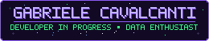

<!--
  ╔══════════════════════════════════════════════════════════════╗
  ║  COMO EDITAR ESTE README                                     ║
  ╠══════════════════════════════════════════════════════════════╣
  ║  1. Envie a pasta "assets" (banner.svg, scene.svg, areas.svg) ║
  ║     para este mesmo repositório, na branch "main".           ║
  ║     As imagens abaixo usam o endereço raw.githubusercontent  ║
  ║     desses arquivos. Se mudar o nome da branch, troque       ║
  ║     "main" nos três links.                                   ║
  ║  2. Procure por "EDITE:" para achar o que pode ser trocado.  ║
  ╚══════════════════════════════════════════════════════════════╝
-->

<!-- EDITE: banner com nome e subtítulo (arquivo assets/banner.svg) -->

 

<!-- EDITE: ilustração pixel art (arquivo assets/scene.svg) -->

 

## ✦ Sobre mim

<!-- EDITE: texto de apresentação. Mantenha curto. -->
Estudante de **Ciência da Computação** na Unimetrocamp e **técnica em Desenvolvimento de Sistemas** pela ETEC Bento Quirino, em formação pelo SENAI Sumaré.

Atuo na área de **Tecnologia da Informação**, com experiência em **Dados e Governança** no Grupo EMS. Meu interesse está em desenvolvimento back-end, desenvolvimento mobile, bancos de dados e análise de dados.

 

<!-- EDITE: áreas de interesse (arquivo assets/areas.svg) -->

 

## ✦ Tecnologias

<!--
  EDITE: para adicionar uma tecnologia, copie uma linha de badge e troque:
    - o nome (antes do "-2a1a5e")
    - o logo (depois de "logo=") — nomes em https://simpleicons.org
-->

**Back-end e programação** 

**Front-end** 

**Mobile** 

**Banco de dados** 

**Dados, BI e ferramentas** 

 

## ✦ Projetos em destaque

<table>
  <tr>
    <td>
      <h3>🏪 TaDaKi</h3>
      Plataforma de divulgação de microempresas, com funcionalidades web, mobile e back-end.
        
      
      
      
      
      
      
      <!--
        EDITE: quando o repositório do TaDaKi estiver público, adicione o link aqui.
        Troque SEU-LINK pelo endereço real e remova as marcas de comentário:
          
        <a href="SEU-LINK">Ver repositório →</a>
      -->
    </td>
  </tr>
</table>

<!--
  EDITE: para adicionar outro projeto, copie o bloco <table>...</table> acima,
  cole logo abaixo dele e troque nome, descrição, tecnologias e link.
-->

 

## ✦ Estatísticas do GitHub

<!-- EDITE: se mudar de usuário, troque "gabrieleCavalcanti" nos dois links abaixo -->

 

---

<!-- EDITE: rodapé discreto -->
feito com café e código · <a href="https://linkedin.com/in/gabrielefcavalcanti">LinkedIn</a>

