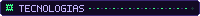
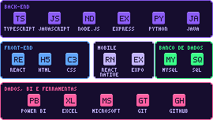
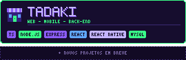
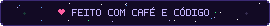

<!--
  ╔══════════════════════════════════════════════════════════════╗
  ║  COMO EDITAR ESTE README                                     ║
  ╠══════════════════════════════════════════════════════════════╣
  ║  1. A pasta "assets" precisa estar neste mesmo repositório,  ║
  ║     na branch "main". As imagens abaixo usam o endereço      ║
  ║     raw.githubusercontent desses arquivos. Se a branch       ║
  ║     mudar de nome, troque "main" nos links.                  ║
  ║  2. Procure por "EDITE:" para achar o que pode ser trocado.  ║
  ╚══════════════════════════════════════════════════════════════╝
-->

<!-- EDITE: banner com nome e subtítulo (assets/banner.svg) -->

 

<!-- EDITE: ilustração pixel art (assets/scene.svg) -->

 

<!-- EDITE: texto de apresentação. Mantenha curto. -->
Estudante de **Ciência da Computação** na Unimetrocamp e **técnica em Desenvolvimento de Sistemas** pela ETEC Bento Quirino, em formação pelo SENAI Sumaré.

Atuo na área de **Tecnologia da Informação**, com experiência em **Dados & IA**. Meu interesse está em desenvolvimento back-end, desenvolvimento mobile, bancos de dados e análise de dados.

<!-- EDITE: áreas de interesse (assets/areas.svg) -->

 

<!--
  EDITE: o quadro de tecnologias é a imagem assets/tech.svg.
  Para incluir ou tirar uma tecnologia, é só pedir o ajuste que o arquivo é regerado.
-->

 

<!-- EDITE: card do projeto (assets/projetos.svg) -->

**TaDaKi** é uma plataforma de divulgação de microempresas, com funcionalidades web, mobile e back-end.

<!--
  EDITE: quando o repositório do TaDaKi estiver público, adicione o link aqui.
  Troque SEU-LINK pelo endereço real e remova as marcas de comentário:
  [Ver repositório →](SEU-LINK)
-->

 

<!-- EDITE: se mudar de usuário, troque "gabrieleCavalcanti" nos links abaixo. Os números se atualizam sozinhos. -->

 

<!-- EDITE: rodapé (assets/footer.svg) -->

<a href="https://linkedin.com/in/gabrielefcavalcanti">LinkedIn</a>

